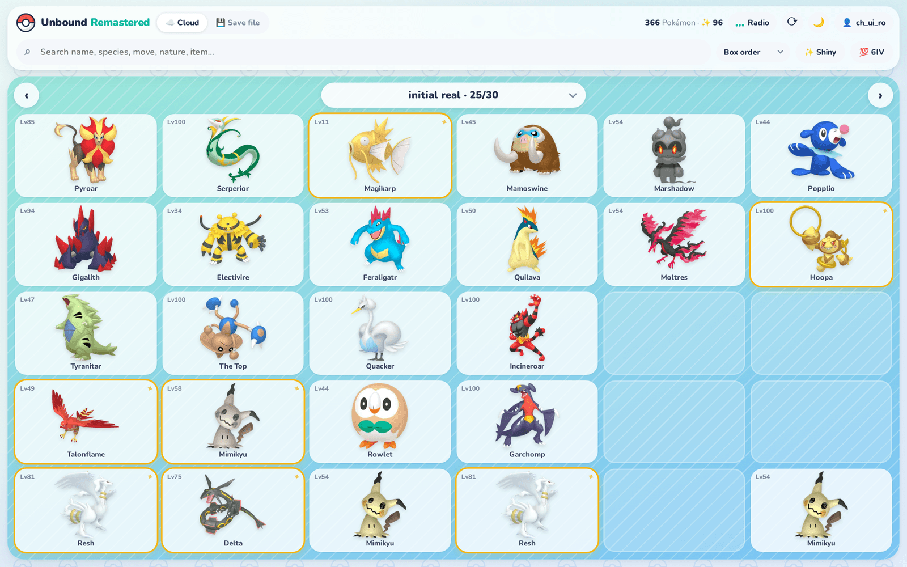
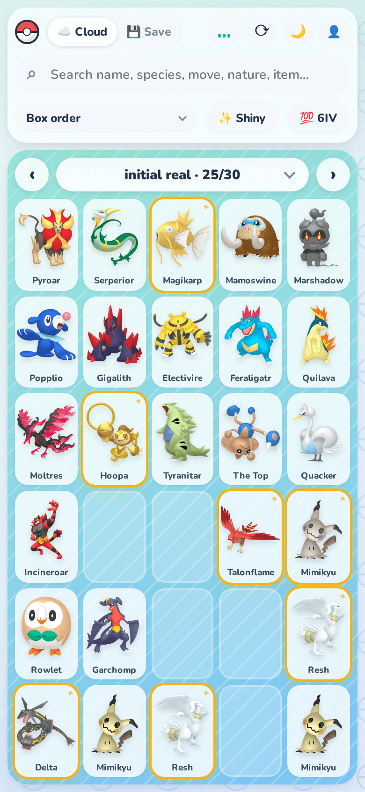
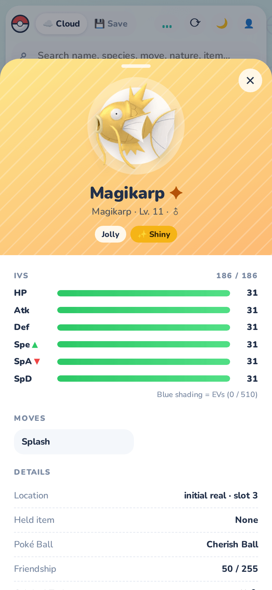
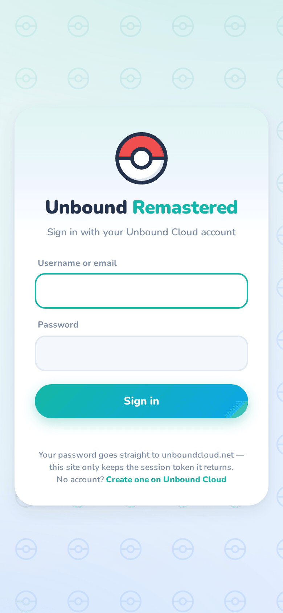
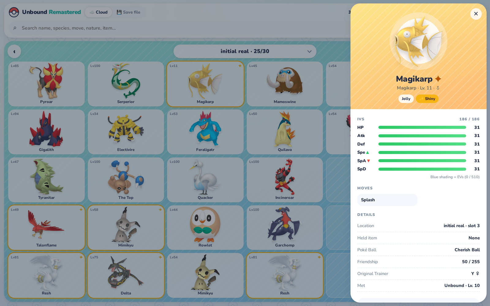
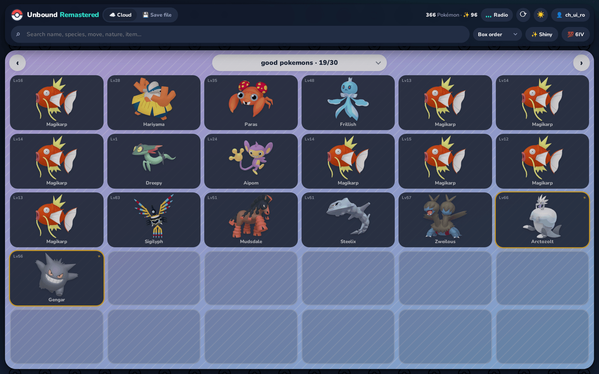
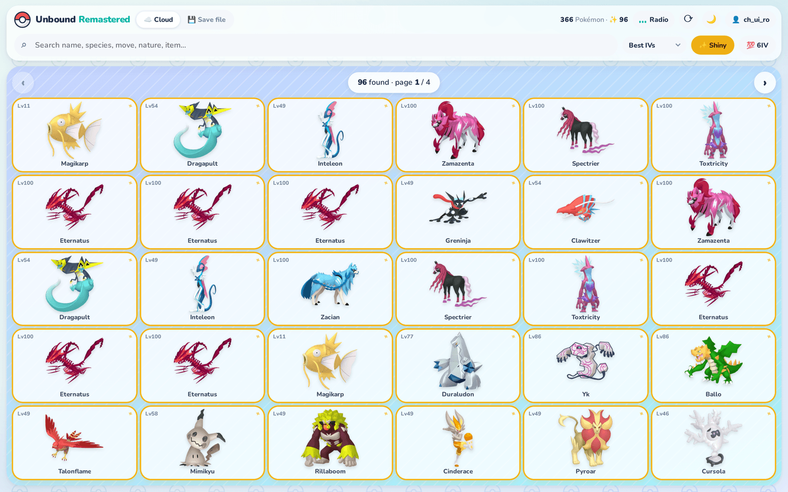
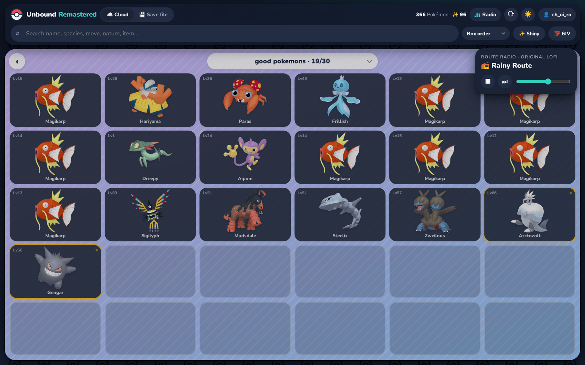
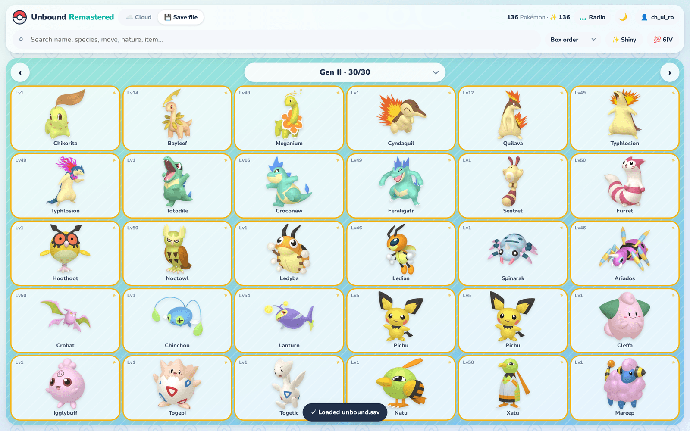
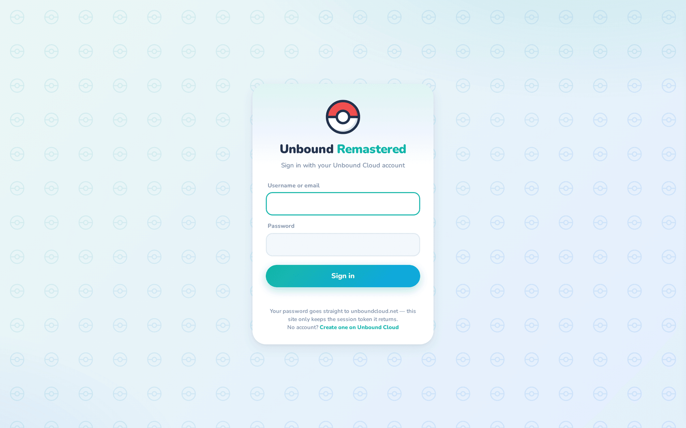

# Unbound Remastered

A modern, mobile-friendly way to browse your **[Pokémon Unbound](https://www.pokecommunity.com/threads/pok%C3%A9mon-unbound-completed.382178/) Cloud** — inspired by Pokémon HOME.

Sign in with your existing [Unbound Cloud](https://unboundcloud.net/) account and you get the **same Cloud boxes**, just nicer: full-screen PC boxes, HOME-style 3D sprites, instant search across every box, IV/EV breakdowns, save-file support, Wonder Trade, dark mode and a built-in lofi radio.



<p align="center">
  
  
  
</p>

## Features

- **Your real Cloud** — log in with your Unbound Cloud username/email + password. Everything is read from (and Wonder Trades are written back to) the official Unbound Cloud, so it stays in sync with the original site and the game.
- **PC boxes that fit one screen** — 6×5 on desktop, 5×6 on phones, 10×3 in landscape. No scrolling. Swipe or ←/→ to change boxes, or jump with the box picker. Every box gets its own wallpaper.
- **HOME-style sprites** — 3D renders (shiny variants included), regional forms (Galarian, Alolan, Hisuian…), resized and cached server-side so boxes load fast.
- **Search everything** — name, species, move, nature, item; multi-word (`shiny jolly`). Filter ✨ shiny or 💯 6IV, sort by best IVs / level / species. Results page 30 at a time.
- **Summary card** — IV bars with EVs shaded underneath, nature ▲▼, moves, ball, held item, OT, met data.
- **Save files** — upload a `.sav` and browse it with the same UI (parsed by Unbound Cloud's own save reader).
- **Wonder Trade** — from your Cloud *or* a save file. Cloud trades save straight back; save-file trades give you an updated `.sav` to download.
- **Route Radio** 📻 — an original, procedurally generated lofi soundtrack (Web Audio, no audio files): jazzy chords, a soft Game Boy–style lead, boom-bap drums, vinyl crackle, rain and waves. Four stations.
- **Light & dark mode**, installable-feeling mobile layout with a bottom-sheet summary.

| | |
|---|---|
|  |  |
|  |  |
|  |  |

## Run it

Requires Node.js 20+.

```bash
git clone https://github.com/0xSolarPunk/unbound-remastered
cd unbound-remastered
npm install
npm start            # → http://localhost:8777
```

Options (environment variables): `PORT` (default `8777`), `HOST` (default `0.0.0.0`), `TRADE_TIMEOUT_MS` (default `120000`).

### Access it from your phone with Tailscale

```bash
tailscale serve --bg 8777
# → https://<machine>.<tailnet>.ts.net, private to your tailnet
```

## How it works

Unbound Cloud's web app is a React SPA backed by a small JSON + Socket.IO API. This project talks to the same endpoints:

| Endpoint | Used for |
|---|---|
| `POST /checkUser` | sign in → account token |
| `POST /getAccountCloudData` | your Cloud boxes, titles and sync key |
| `POST /uploadSaveFile` | parse a `.sav` |
| `POST /getUpdatedSaveFile` | re-encode a `.sav` after a trade |
| `POST /saveAccountCloudData` | write Cloud boxes back after a trade |
| Socket.IO `tradeType` / `message` | Wonder Trade |

`server.js` is a single dependency-light Node server (stdlib HTTP + `socket.io-client` + `sharp`). It proxies those calls so the browser never needs CORS, and keeps a per-browser session.

## Privacy & security

- Your password is sent only to `unboundcloud.net` to sign in. It is **never stored**. The server keeps the account token Unbound returns, in `data/sessions.json` (30-day, HttpOnly cookie).
- Cached Cloud data and sessions live in `data/`, which is git-ignored.
- Host it for yourself (or friends you trust): whoever runs the server can see the account tokens of people who sign in.

## Disclaimer

Fan project, not affiliated with Nintendo, Game Freak, The Pokémon Company, or the Pokémon Unbound / Unbound Cloud developers. Pokémon and Pokémon character names are trademarks of Nintendo. Sprites are loaded at runtime from [PokeAPI/sprites](https://github.com/PokeAPI/sprites) and [msikma/pokesprite](https://github.com/msikma/pokesprite); none are bundled. The music is original and generated in code.

License: MIT
